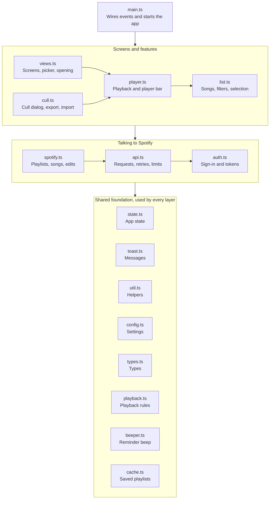

# Project layout

Each module owns one concern. Spotify network code sits in three files, and only `list.ts`, `player.ts`, `views.ts` and `cull.ts` render the page's content.

| File | Owns | Main exports |
| --- | --- | --- |
| `index.html` | Fixed markup: top bar, setup screen, picker, workspace, player bar, dialogs | — |
| `src/styles.css` | All styling, light and dark themes | — |
| `src/main.ts` | Entry point: wires every button and shortcut, runs start-up, group rating | `init` (runs on load) |
| `src/config.ts` | URLs, OAuth scopes, batch sizes, storage key names | `API`, `SCOPES`, `KEY`, `WRITE_BATCH` |
| `src/types.ts` | App types and the Spotify response shapes the app reads | `Track`, `Source`, `RatingEntry`, `Paging` |
| `src/util.ts` | DOM lookup, localStorage wrapper, formatting, icons, star HTML | `$`, `LS`, `esc`, `fmt`, `starsHtml` |
| `src/toast.ts` | Notification bar with optional Undo or link | `toast` |
| `src/state.ts` | The single app state object, ratings and play history | `S`, `setRating`, `markPlayed`, `setTracks` |
| `src/auth.ts` | PKCE sign-in, token storage and refresh | `login`, `handleRedirect`, `getToken` |
| `src/api.ts` | Web API client: retries, refresh on 401, waits on 429 | `api`, `SpotifyError` |
| `src/spotify.ts` | Reading playlists and songs, removing songs, creating playlists, devices | `getSources`, `getTracks`, `removeFromSource` |
| `src/list.ts` | Song list: filtering, sorting, rows, selection, progress summary | `renderList`, `updateRow`, `toggleSel` |
| `src/playback.ts` | The playback state machine: every rule about what playback does next | `transition`, `Playback` |
| `src/player.ts` | Runs the state machine, talks to Spotify's player, draws the player bar, device dialog | `dispatch`, `playSong`, `togglePlay`, `rateCurrent` |
| `src/beeper.ts` | The reminder beep for **Wait for a rating** | `setBeeping`, `primeBeeper` |
| `src/cache.ts` | Saved copies of playlists' songs | `loadCached`, `saveCached`, `isStale` |
| `src/views.ts` | Switching screens, setup screen, playlist picker, opening a playlist | `show`, `renderPicker`, `openSource` |
| `src/cull.ts` | Cull dialog, confirm dialog, keepers playlist, ratings export and import | `openCull`, `removeTracks`, `exportRatings` |
| `src/mock/data.ts` | The test library for test mode: songs, playlists, covers | `buildLibrary` |
| `src/mock/server.ts` | Simulated Spotify Web API and playback for test mode | `mockFetch` |
| `src/env.d.ts` | Declares the build-time `__MOCK__` flag | — |
| `vite.config.ts` | Dev server address and port, relative build paths, test mode flag | — |
| `tsconfig.json` | Strict TypeScript settings, Spotify SDK types | — |

## Module dependencies

The modules form four layers, and each imports only from its own layer or the ones below it, so there are no circular imports. Each arrow points from a module to what it imports.

`main.ts` imports from every other module. Within the features layer, `views.ts` and `cull.ts` use `player.ts` and `list.ts`, and `player.ts` uses `list.ts`; `list.ts` imports nothing from Spotify. `player.ts` and `views.ts` also import from `api.ts` and `auth.ts` directly: `player.ts` for playback requests and the browser player's token, `views.ts` for error messages and the saved Client ID. `cull.ts` uses `api.ts`'s error helpers too.

`playback.ts` imports nothing at all: it's pure logic that `player.ts` runs.

To keep it this way, lower modules report back rather than reach up. For example, `markPlayed` in `state.ts` returns whether a song is newly played, and the caller decides what to redraw.
